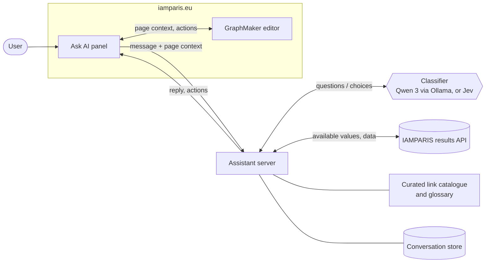
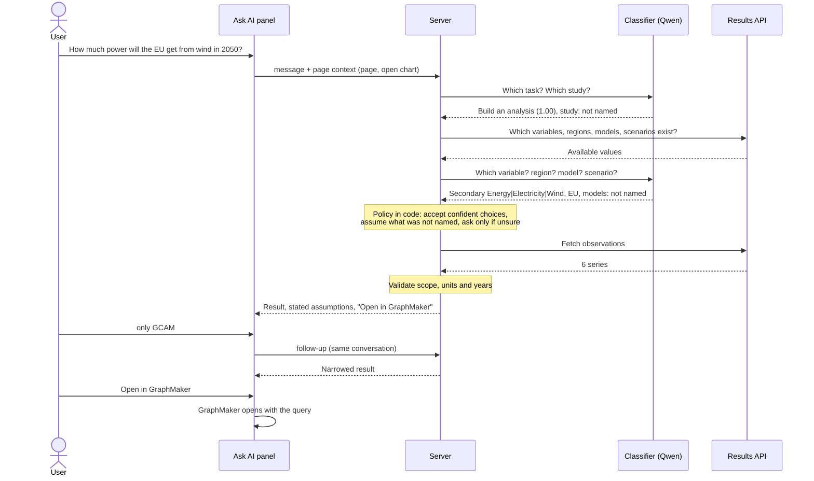

# IAMPARIS Ask AI assistant: how it works

## Summary

The IAMPARIS assistant is a side panel on iamparis.eu ("Ask AI") that helps users find data, pages and definitions, and can work directly on the chart they have open in GraphMaker. Unlike a conventional chatbot, **no language model writes the answers**. A small classifier only *chooses* among options the application supplies: which task, which variable, which region. Ordinary code then fetches the data and builds the reply. Every value on screen was either typed by the user or returned by the IAMPARIS results API or a curated catalogue, so the assistant cannot invent facts.

The design follows the "System One" approach of TypeSafe's Jev and the open-source Jev Chat. It runs on a local Qwen 3 (4B) model through Ollama, the same runtime as the earlier IAMPARIS chatbot. Hosted Jev can be used instead.

## Components

- **Ask AI panel**: a panel docked on the right of the site, styled after Vercel's Ask AI. It shows the page or chart it is talking about and can be dismissed so nothing is shared.
- **Assistant server**: holds each conversation, asks the classifier, applies the decision policy, calls the data API and builds replies.
- **Classifier**: answers multiple-choice questions with a probability for every option, plus "none".
- **Results API and catalogues**: the only sources of data, links and definitions.

## One request, start to finish

Example: *"How much power will the EU get from wind in 2050?"*

### How the classifier is asked

Each question lists the candidate values as lettered options (A, B, C … and Z for "none of these"). The model's reply is pre-filled up to *"Answer:"*, so it generates a single token, and the probabilities of the letters form the decision. Each question costs one short request and **one output token**, roughly 30–60 ms on a laptop GPU. A full request typically takes two rounds of questions and answers in under a second once the model is loaded. Candidate lists are pre-ranked by word overlap, and exact wording matches ("CO2 emissions", "Europe" → EU, "Germany" → DEU) are recognised without the model at all.

### Decision policy (plain code)

| Classifier result | What the assistant does |
|---|---|
| A curated phrase names a value ("current policies", "CCS") | Use it without asking the classifier |
| One option clearly wins (≥ 72 %, ahead by ≥ 15 points) | Use it, if the request names it (models, scenarios, specialised studies) |
| "Not mentioned" (e.g. no model named) | Assume a sensible default and **say so** in one sentence (all models, World or EU, a general study, the study's headline scenarios) |
| Undecided between options | Ask once, best guess first, four suggestions, the rest behind search |
| Requested value has no data | Keep the previous query and explain why |
| Several models report different units | Keep the most common unit and say which models were left out |

Most requests therefore end in a result straight away, with one clarifying question at most.

## Working on the live page

- **Shared session**: each browser has an opaque assistant session, and each tab keeps its own conversation. Follow-ups such as "only solar", "same for Germany" or "what about 2030 to 2050" refine the current query, and tabs never share context. This also covers the session handling noted for the previous chatbot.
- **Page context**: every message carries a small snapshot of what the user sees: the current page and, if GraphMaker is open, its study, filters, years and chart type.
- **Actions**: replies can carry actions from a fixed list. They can navigate to a catalogued page, open a result in GraphMaker, or change the open chart's filters or chart type. Changes to the user's chart need one click and can be undone. Nothing in a reply is executed as code.
- **"Describe what my chart shows"**: answered from the chart's own data with fixed sentence templates (trend per series, peaks, highest vs lowest, gap). No model call is made.

## Why this approach

- **Grounded**: answers are data, catalogue links or curated definitions. Nothing is generated.
- **Cheap and private**: one output token per question on a small local model. No external API is needed, and no user text leaves the server.
- **Inspectable**: every reply stores the questions asked, the options offered and the probabilities, so any decision can be traced.
- **Predictable**: behaviour lives in code, not in prompts, and is covered by 56 automated tests.

## Status and limitations

- Working prototype, integrated into the IAMPARIS frontend and checked in the browser against the live results API.
- Scope: data queries (one variable, region and model set at a time, with comparisons of models, scenarios and years), site navigation, curated definitions, model profiles from the IAMPARIS model registry, and actions on the open chart. Measured against the previous chatbot in `old-vs-new.md`.
- The assistant only sees charts open in the GraphMaker editor dialog, not charts embedded inline on other pages.
- A 4B model occasionally misreads unusual wording. The policy then asks rather than guesses, but semantic accuracy has not yet been measured systematically.
- Before public deployment, the server needs hosting, authentication and a production origin policy. Today it runs locally.
