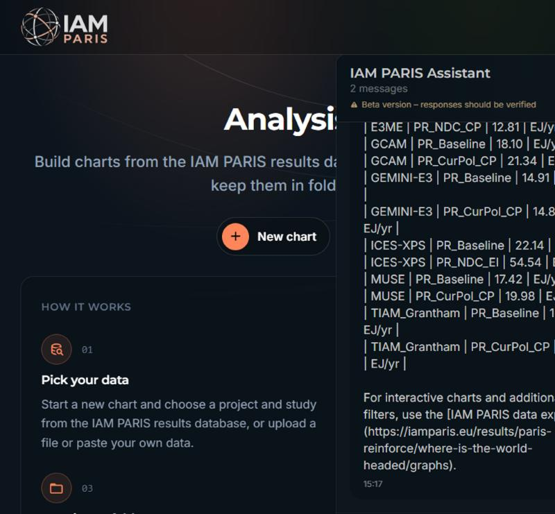
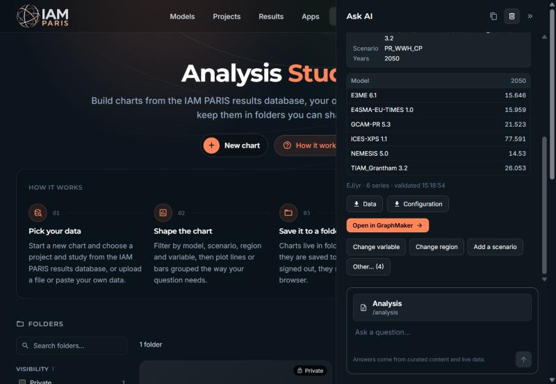
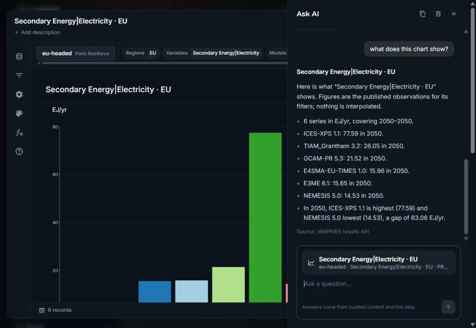

# From iam-data-chatbot to iamparis-assistant

*Measured on 30 October 2026. The old assistant ran in production at `chat.iamparis.eu`; the new one ran locally with Qwen 3 4B through Ollama on an RTX 5070 Ti.*

## What changed

| | iam-data-chatbot (old) | iamparis-assistant (new) |
|---|---|---|
| How answers are produced | Python pipeline: deterministic rules and extraction, with an LLM (OpenAI or Qwen 3 0.6B) for routing, extraction and free-form answers | A classifier only **chooses** among supplied options (one output token per question). Code fetches data and writes every reply from templates |
| Generated text | Possible on the general Q&A path | None: every value comes from the user, the results API, the model registry or a curated catalogue |
| Model | gpt-4o-mini / gpt-4o, or qwen3:0.6b, plus an embedding index (FAISS) | qwen3:4b via Ollama with real option probabilities (or hosted Jev). No embeddings needed |
| Knowledge | Rules, aliases, definitions, link catalogue | IAMC variable definitions as option text (68% of published variables), region names, model registry, link catalogue, glossary |
| Decision policy | Spread across rules, prompts and confidence fields | One explicit policy: use a confident pick, assume and state a default, ask once with numbered suggestions, or explain missing data |
| Website UI | Floating chat bubble bottom-right; Markdown shown as raw text | Ask AI side panel (Vercel style): docked on wide screens, side sheet on laptops, full screen on phones |
| Page awareness | None | Every message carries the current page and the open GraphMaker chart |
| Acting on the page | Links only | Opens pages itself, opens results in GraphMaker, changes the open chart (filters, chart type) with Undo |
| Sessions | `session_id` returned but not sent back by the widget; a server workaround grouped requests by IP and browser | Per-browser session; one conversation per tab, kept across reloads, never shared between tabs |
| Explainability | Route and entity fields in the response | Every reply stores each question, the options offered and their probabilities |
| Code size (excluding tests) | ~31,800 lines of Python in 67 files | ~2,300 lines of server code (TypeScript) + ~870 lines for the website panel |

## Before and after

**Before**: the floating widget on iamparis.eu, answering "electricity generation for EU in 2050". The data table arrives as raw Markdown text.

**After**: the same question in the Ask AI panel. It shows a structured result with stated assumptions, a data table, downloads, *Open in GraphMaker* and suggested changes.

**After**: the result opened in GraphMaker with one click. "What does this chart show?" is answered from the chart's own data.

## Use cases measured

Both assistants received the same 15 turns in 9 conversations, twice. Follow-ups stayed in the same session. Times are end-to-end per turn, first run / second run. Old-bot times include the network to the production server, roughly 0.1–0.3 s.

| Turn | Old: result | Old ms | New: result | New ms |
|---|---|---|---|---|
| electricity generation for EU in 2050 | ✅ data (world study) | 1822 / 1085 | ✅ data (EU study) | 648 / 406 |
| → only solar | ✅ | 1240 / 1243 | ✅ | 1121 / 343 |
| → same for Germany | ✅ switches study | 1529 / 1575 | ✅ switches study and says so | 1010 / 402 |
| → what about 2040? | ✅ | 1096 / 1079 | ✅ | 6729* / 364 |
| How much power will the EU get from wind in 2050? | ⚠️ wrong variable, then offers choices | 2192 / 1988 | ✅ Secondary Energy\|Electricity\|Wind | 777 / 394 |
| → only GCAM | ❌ no data (wrong variable) | 1165 / 1162 | ✅ | 573 / 306 |
| Compare CO2 emissions in Europe in 2050 | ✅ | 1430 / 1431 | ✅ | 637 / 519 |
| Where can I find the model catalogue? | ✅ link | 191 / 198 | ✅ opens the page | 207 / 163 |
| where can I compare models side by side? | ✅ link | 171 / 176 | ✅ opens the page | 273 / 189 |
| What is a baseline scenario? | ✅ definition | 110 / 115 | ✅ definition | 257 / 155 |
| What does net zero mean? | ✅ definition | 109 / 101 | ✅ definition | 245 / 186 |
| energy in buildings for EU | ✅ numbered choices | 1228 / 1039 | ✅ numbered choices | 485 / 370 |
| → 1 | ✅ answers choice 1 | 374 / 378 | ✅ answers choice 1 | 547 / 95 |
| tell me about GCAM | ✅ model profile | 628 / 618 | ✅ model profile + page link | 4 / 5 |
| → who developed it? | ❌ empty reply | 234 / 85 | ✅ "developed by Joint Global Change Research Institute" | 4 / 4 |
| **Score** | **12 ✅ · 1 ⚠️ · 2 ❌** | | **15 ✅** | |

\* One slow uncached data request; 0.36 s on the second run.

Not in the table, because only the new assistant can do them: opening a result in GraphMaker, describing the chart on screen, switching it to a bar chart and back, and opening pages without a click.

## Accuracy on the earlier chatbot's test sets

Both assistants answered the old chatbot's 231 labelled single-turn queries: its tuning set, its natural-language set and its held-out set. The scores are the share where each picked the expected kind of task, and the expected variable and region where the set names one. Old-bot requests were paced to respect its rate limit, and none failed.

| | Old | New (start of this round) | New (now) |
|---|---|---|---|
| Kind of task (231 queries) | **91%** | 62% | 82% |
| … held-out set only (72) | **92%** | – | 76% |
| Variable (68 labelled) | **63%** | 50% | 60% |
| Region (77 labelled) | 61% | 68% | **75%** |
| Median time per query | 0.75 s | 0.34 s | **0.46 s** |

These test sets were written to tune the old bot, so it has a home advantage, most visibly on choosing the task. The new assistant's remaining task misses are mostly listing questions ("list regions", "which models are available"), which it doesn't support yet. Some labels are also debatable: "solar PV capacity" is labelled as the aggregate `Capacity|Electricity|Solar`, while the new assistant returns `…|Solar|PV`.

## Is it faster and more efficient?

**Speed.** Median per turn in the use cases was **0.36 s for the new assistant against 1.08 s for the old one**. In the 231-query evaluation it was 0.46 s against 0.75 s.

| Kind of turn | Old (median) | New (median) |
|---|---|---|
| Data queries | 1.43 s | **0.52 s** |
| Data follow-ups | 1.16 s | **0.40 s** |
| Links, definitions, model profiles | **0.18 s** | 0.19 s |

The new assistant caches available values for 5 minutes and the model registry for an hour; first-run medians are 0.65 s (data), 1.0 s (follow-ups) and 0.25 s (lookups).

**Model usage.** The old assistant reported that the use-case turns were answered by deterministic rules, with no LLM call. Its rule base is large: about 32,000 lines. The new assistant made 54 classifier calls in 15 turns: about 1,300 input tokens and **one output token per call**. That runs locally on the GPU, costs nothing per query and sends no user text to an external service. Model profiles, follow-ups about them, numbered replies and chart descriptions use no model call at all. The old LLM paths (general Q&A, LLM extraction) used hosted gpt-4o models whenever rules did not apply.

**Simplicity.** The new assistant, server and website panel together, is about a tenth of the old codebase. 56 automated tests cover its decision policy.

## Verdict and next steps

The new assistant is **faster, integrated into the website, able to act on the user's chart, explainable and much smaller**. It now handles every use case above, including the ones the old bot covered and it did not: study switching, numbered replies and model profiles. It finds regions more reliably and matches the old bot on variables. On the old bot's own test sets it still chooses the kind of task less often correctly: 82% against 91%, and 76% against 92% on the held-out set. That gap should be closed, mainly by supporting listing questions, before the old service is retired.

Next steps:

1. **Listing questions** ("list regions", "which models are available", "how many models are there?"). These aren't supported yet and are the main remaining gap in the test sets.
2. **Step-by-step variable choice** following the IAMC hierarchy. In the evaluation, most variable misses were about the right level of detail or genuinely ambiguous requests (GDP MER vs PPP, CO2 vs all greenhouse gases), not about finding candidates. So this was postponed in favour of dropping unrequested detail, which addressed those misses directly.
3. **Curate the remaining 32% of variables** without a definition, and add one-line explainers for scenario codes such as `PR_CurPol_CP`.
4. **Hosting and authentication** before it replaces the old service.

The benchmark and evaluation scripts and their raw results are in [`benchmark/`](benchmark/) (`node bench.mjs 2`, `node ../../scripts/eval.mjs ../../../iam-data-chatbot`).
