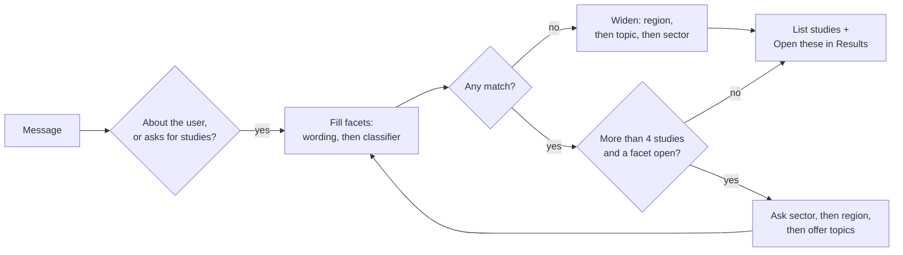

# Study filtering: the Results page and the assistant

The assistant can pick studies for someone ("I work on industry policy at the German economics ministry") by driving the same filter as the Results page at `iamparis.eu/results`. This page explains that filter and how the assistant uses it.

## The filter on the Results page

Every study carries values for four **facets**: sector, region, topic and project.

| Facet | Values | Where a study's values come from |
| --- | --- | --- |
| Sector | Energy supply, Industry, Buildings, Transport, Agriculture & land use, Economy-wide | The share of its IAMC variables per sector, or a sector its title or description names. Data spanning four or more sectors is Economy-wide. |
| Region | Global, EU, or up to six countries | Its region codes (ISO2, ISO3 and model spellings are recognised). For global datasets the title decides the focus. |
| Topic | 34 tags (Steel, Hydrogen, NDCs, Trade…) | A tag covering at least 15% of its variables or 25% of its scenarios, or named in its text. At most eight per study. |
| Project | PARIS REINFORCE, TRANSIENCE… | The CMS link between study and project. |

The rules live in the frontend (`src/lib/config/studyTaxonomy.js`, `utils/data/studyFacets.js`). An editor can override or extend any study's values in `src/lib/data/studyMetadata.js`.

Filtering follows one rule: **values within a facet are OR-ed, facets are AND-ed.** "Industry or Transport, and in Germany". The number beside each option is how many studies it would show given every *other* facet, so choosing Germany does not zero out the other regions. The selection lives in the URL (`/results?sector=industry&region=germany`), which makes a filtered view shareable.

## How the assistant uses it

`data/studies.json` is a snapshot of all studies with their facet values. `scripts/build_study_catalogue.mjs` builds it by importing the frontend's own facet code and feeding it the CMS study list and the results API, so the assistant never re-implements the derivation. `apps/server/src/tools/studies.ts` applies the OR/AND rule and the counts to that snapshot. As everywhere in the assistant, no text is generated: studies, labels and counts all come from the snapshot.

1. **Detect.** A message that describes the user ("I work at…", "as a policy advisor") or asks which studies are relevant starts a study search. The classifier can also choose the task "Find studies for me".
2. **Understand.** A facet value named outright is taken first, by its label or by an everyday phrase from the `facets` section of `data/curation.json` ("German" → Germany, "steelmaker" → Industry, "energy ministry" → Energy supply). Several values may be named. The classifier is asked only about facets still open, so it can infer a sector from a role ("I run a truck fleet" → Transport). An inferred value is stated as such so the user can correct it. Economy-wide is never inferred: it must be named or chosen.
3. **Ask what is missing.** While more than four studies match, the assistant asks for the sector, then the region, one question per turn, each option with its count and an "Any…" choice. With more than six left it offers the topics. Once a list has been shown it stops asking.
4. **Widen instead of returning nothing.** If nothing matches, the region is widened first (a member state to EU-wide studies, then global, then any region), then the topic is dropped, then the sector. The reply says what was widened.
5. **Show.** Up to eight studies, most specific first, with the facets that matched highlighted. **Open these in Results** carries the selection in the URL, so the page opens with the same filter set. Follow-ups change the list: "what about Poland?", "also hydrogen", "any region", or the buttons (include EU-wide studies, change sector, narrow by topic).

Example: *"I work on buildings policy for the Greek government"* → sector Buildings ("buildings"), region Greece ("Greek") → no such study → widened to Greece or EU → one study, with the widening explained.

## What to edit

| Situation | Change |
| --- | --- |
| A study was added, or facets changed on the site | `node scripts/build_study_catalogue.mjs ../../i2amparis-frontend` |
| A study has a wrong sector, region or topic | Fix it in the frontend's `studyMetadata.js` (it changes the page too), then rebuild |
| A phrase is not recognised ("Hellenic", "ETS") | Add it under `facets` in `data/curation.json` |
| Ask more or fewer questions | `enough` and `topicAbove` in `apps/server/src/turn/studies.ts` |
| A reply must stay fixed | Add the conversation to `scripts/curation-cases.json`, run `node scripts/curation-check.mjs` |

## Debugging a reply

The decision inspector lists every step of a turn: which facet was read from which words, what the classifier was asked and how confident it was, which rule asked a question or widened the filter, and the selection the turn left behind. "Copy JSON" exports the whole trace.

## Limits

The snapshot is as fresh as its last rebuild (its date is shown as the source of each list). Wording matches are per word, so "carbon transport and storage" also names Transport. The assistant filters by facet only; it does not search study text the way the page's search box does.
