# The IAM PARIS assistant: a short guide

The assistant helps you find your way around IAM PARIS by asking it in plain words. It can fetch model results, pick the studies that matter to you, find a tool, point you to the right page, or explain a term.

It does not make up answers. A small language model (the _classifier_) only ever chooses from fixed lists: which task you want, which variable, which region. Every sentence you read is written by the assistant's own code, and every number comes straight from the live IAMPARIS results. When it isn't sure, it asks you instead of guessing.

The screenshots below come from real conversations on 18 November 2026, using the local `qwen3:4b` classifier.

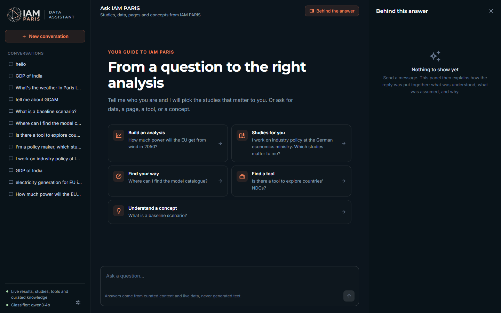

The screen has three parts:

- **Left:** your conversations, a **New conversation** button, and whether the data sources and the classifier are working. The sun/moon button switches between dark and light mode.
- **Centre:** the conversation. A new conversation offers five starting points; click one or type your own question.
- **Right:** **Behind this answer** explains how the selected reply was put together. Open or close it with the button at the top, or with **Why this answer?** next to any reply.

## What you can ask

| You want to…               | Try asking                                                                                | You get                                                    |
| -------------------------- | ----------------------------------------------------------------------------------------- | ---------------------------------------------------------- |
| See numbers                | "How much power will the EU get from wind in 2050?"                                       | A data table, a link to open it in Analysis, and downloads |
| Find studies for your work | "I work on industry policy at the German economics ministry. Which studies matter to me?" | Study cards, filtered the same way as the Results page     |
| Find a tool                | "Is there a tool to explore countries' NDCs?"                                             | Tools from the Application Library                         |
| Find a page                | "Where can I find the model catalogue?"                                                   | A button that opens the page                               |
| Understand a term          | "What is a baseline scenario?"                                                            | A curated definition                                       |
| Learn about a model        | "Tell me about GCAM", then "who developed it?"                                            | The model's profile                                        |

You can follow up in a few words ("only solar", "same for Germany", "what about Poland?"). The assistant remembers what you were looking at.

## 1. Getting numbers

Ask for a quantity, a place and, if you like, a year. The assistant works out the variable, region, study, models and scenarios, then fetches the published values.

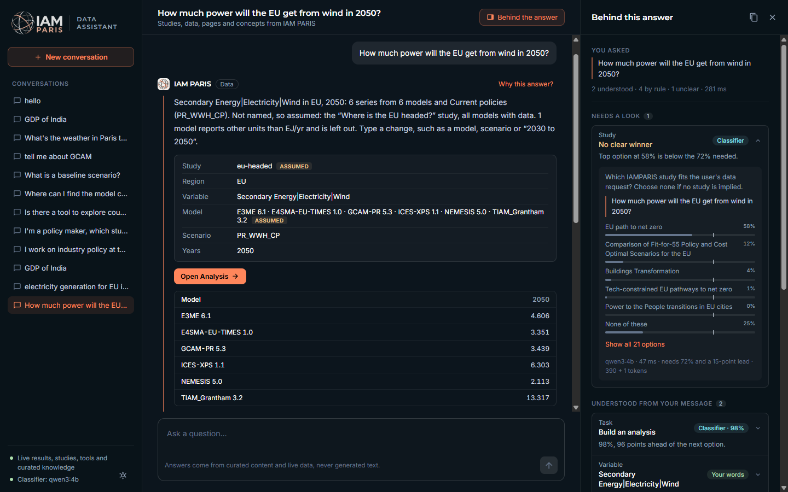

- The grey box lists exactly what was queried. Anything you didn't say is marked **ASSUMED**: here the study and the set of models.
- **Open Analysis** opens the same query in the IAMPARIS Analysis tool. **Data** and **GraphMaker configuration** download it.
- The buttons at the bottom (Change variable, Change region…) refine the query, but you can also just type the change.

Follow-ups change one thing at a time and keep everything else:

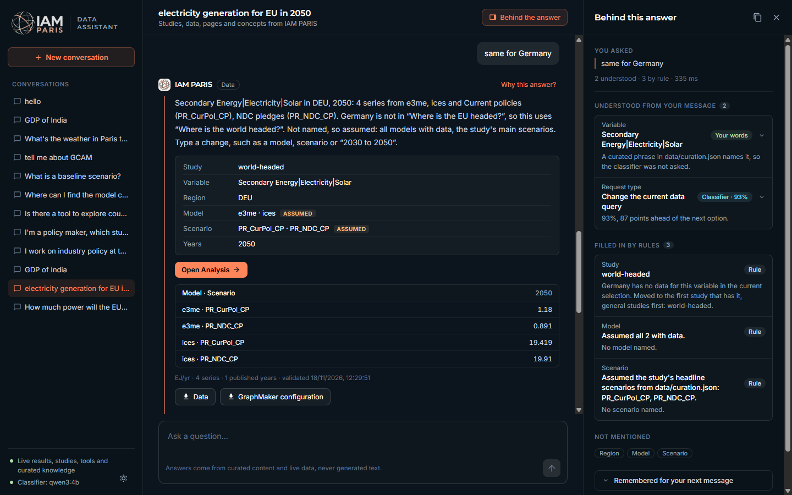

Here the conversation went "electricity generation for EU in 2050", then "only solar", then "same for Germany". Germany isn't in the EU study, so the assistant moved to the global study and says so in the reply. The panel on the right shows that this was a rule, not a guess.

## 2. When it isn't sure, it asks

If a question could mean several things, the assistant asks rather than picking one for you. Each choice has a number: click it, or type the number.

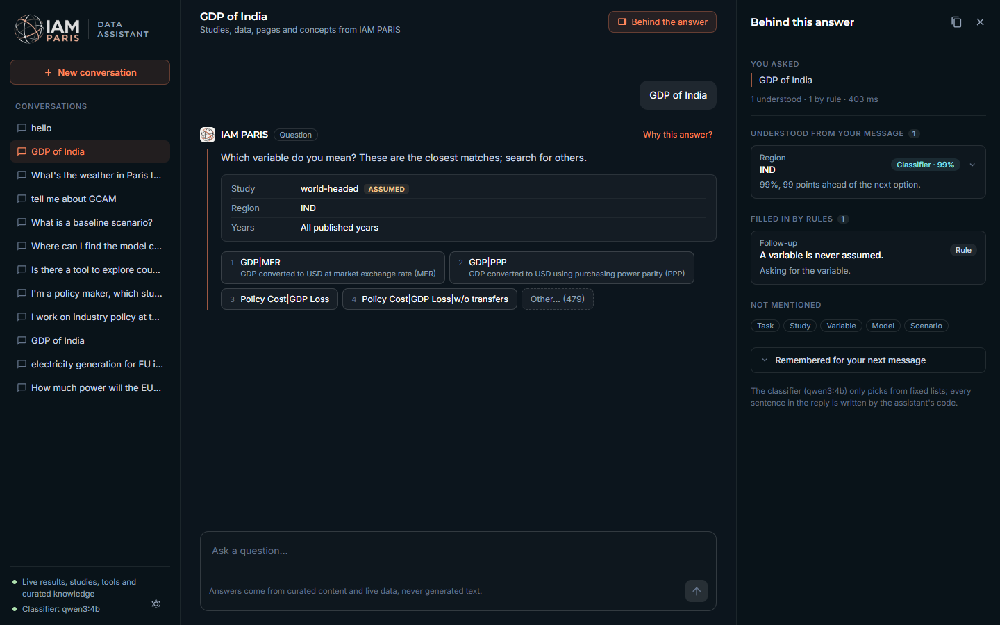

"GDP of India" could mean GDP at market exchange rates or at purchasing power parity. The classifier didn't pick either with enough confidence, and a variable is never assumed, so the reply offers the closest ones. **Other…** and the search box reach the full list of 500+ variables. On the right, the rule that asked the question is listed under **Filled in by rules**. When the classifier leans towards an option without being sure, that option appears under **Needs a look**, with its scores.

## 3. Studies for you

Tell the assistant who you are or what you work on. It reads the sector, region and topic from your words and filters the studies the same way the Results page does.

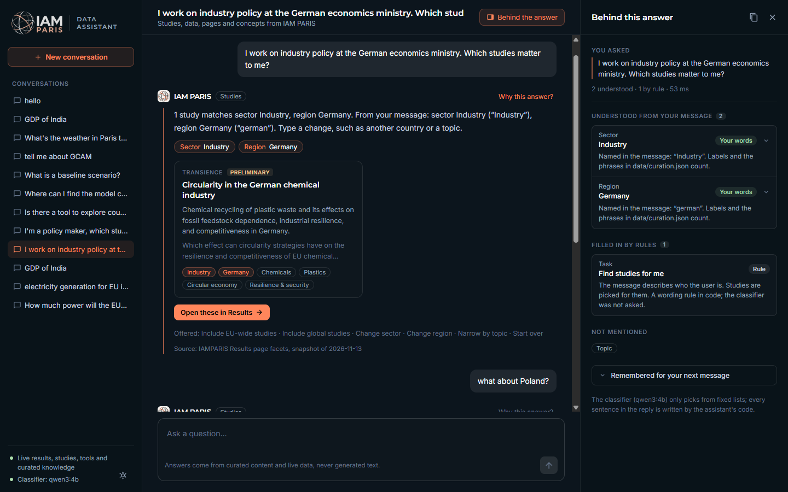

From "industry policy at the German economics ministry" it understood sector **Industry** and region **Germany**, both marked _Your words_ on the right. The orange chips on each card show why the study matched. **Open these in Results** opens the Results page with the same filter. Typing "what about Poland?" swaps the region and keeps the sector.

If your description is vague, it asks one short question at a time:

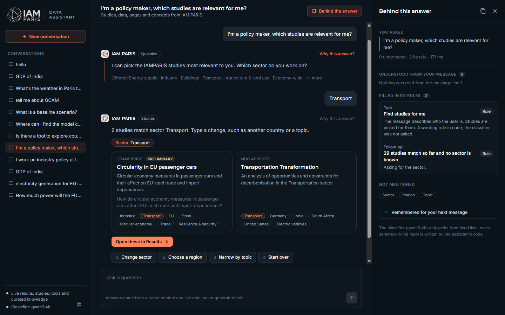

"I'm a policy maker" doesn't say which sector, so the assistant asks for one. After a single click on **Transport**, only two studies were left, so it showed them instead of asking about the region too. If nothing matches, it widens the search step by step (a country, then EU-wide, then global) and tells you it did.

## 4. Finding a tool

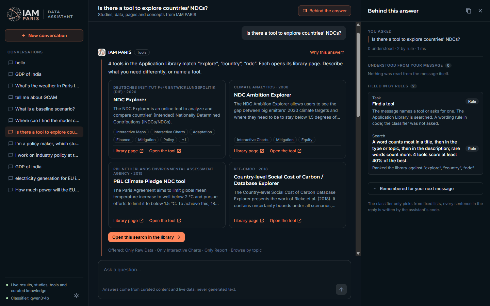

Tool questions search the Application Library. Each card links to the tool's library page and to the tool itself. The buttons narrow the list by type (raw data, maps, charts, reports), or you can type a new subject ("what about forests?").

## 5. Pages, terms and models

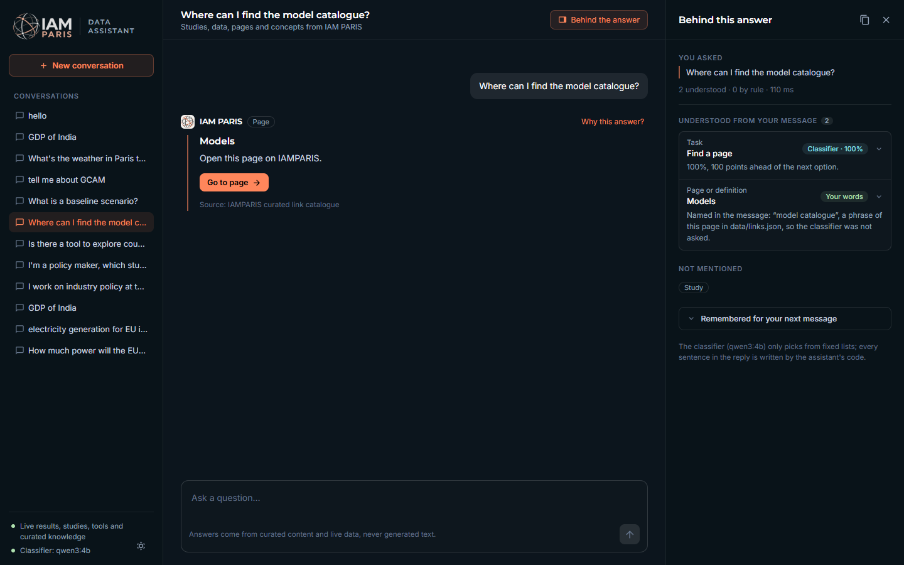

"Where can I find…?" questions give you a button to the right page on IAMPARIS. The assistant never opens a page without your click.

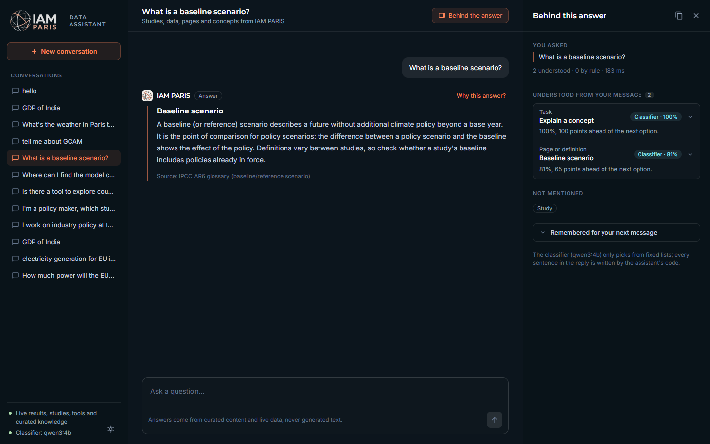

Terms such as _baseline scenario_, _carbon budget_ or _NDC_ get a curated definition and, where useful, a link for more. Model questions ("tell me about GCAM") get the model's profile, and follow-ups such as "who developed it?" stay on the same model.

## 6. Anything else

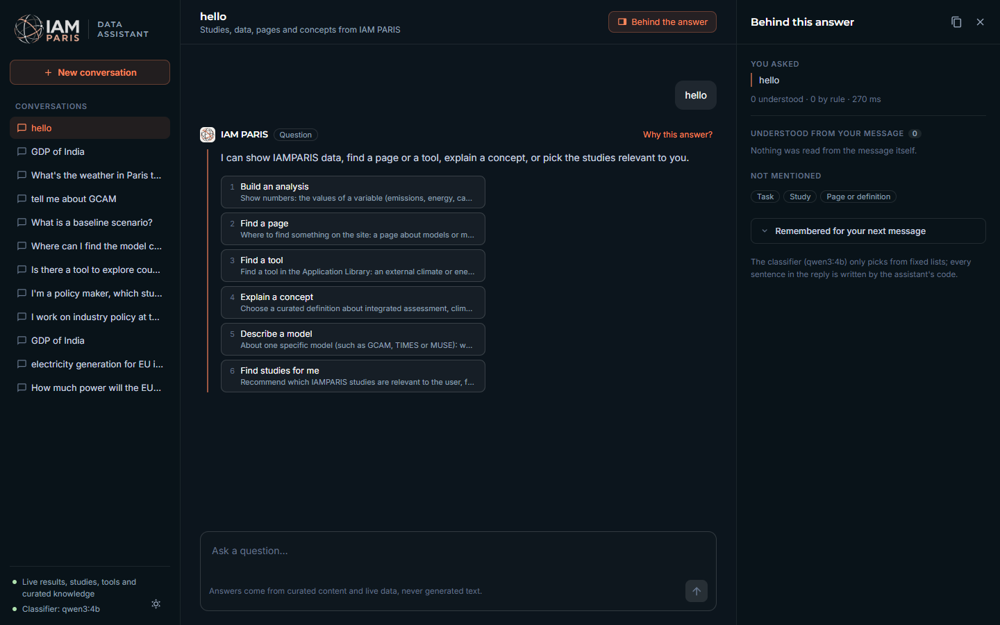

A greeting or an unrelated request ("hello", "write me a poem") gets a short menu of what the assistant can do. One quirk: a question that contains a term from the glossary, such as "What's the weather in **Paris** tomorrow?", is read as a question about that term, and the assistant asks which one you mean.

## Reading "Behind this answer"

The right-hand panel answers one question: _how did the assistant arrive at this reply?_ It is grouped so you can read it from top to bottom.

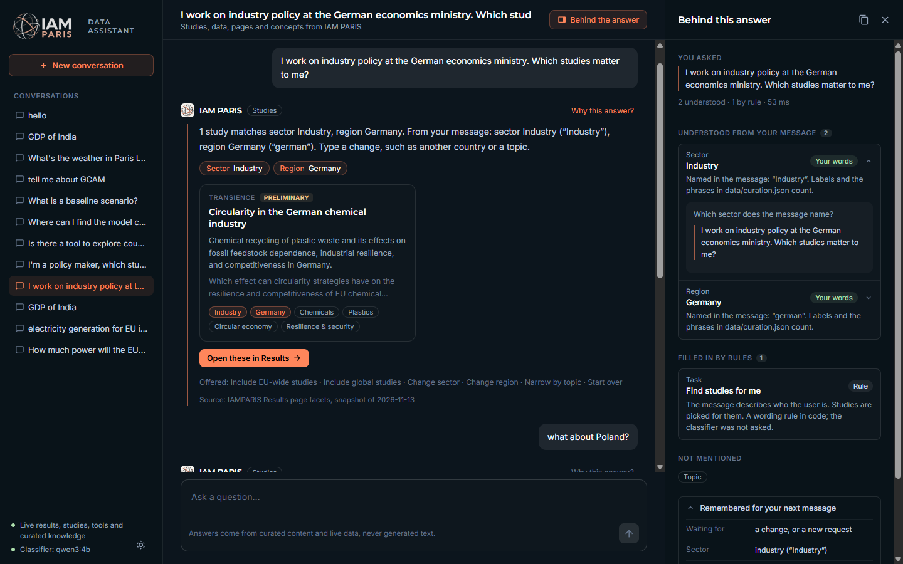

1. **You asked:** the message being explained, with a one-line count and the response time.
2. **Needs a look:** only shown when something was unclear: the classifier wasn't confident enough, a rule overruled it, or the classifier couldn't be reached.
3. **Understood from your message:** each value the assistant took from your words. Click a row to see the question the classifier was asked and how it scored every option. The small mark on each bar is the confidence it needed.
4. **Filled in by rules:** decisions the code made for you, such as assuming every model with data, moving to another study, or deciding whether to ask a follow-up.
5. **Not mentioned:** things you didn't specify.
6. **Remembered for your next message:** what a short follow-up like "only solar" will be applied to.

The tag on each value says who decided it:

| Tag                  | Meaning                                                             |
| -------------------- | ------------------------------------------------------------------- |
| **Your words**       | Found word for word in your message, so the classifier wasn't asked |
| **Classifier · 82%** | Chosen from a fixed list by the classifier, with its confidence     |
| **You chose**        | You clicked it                                                      |
| **Rule**             | Decided by a fixed rule in the assistant's code                     |

The copy button at the top of the panel copies the full reply as JSON, which is handy for reporting a wrong answer.

## Light mode

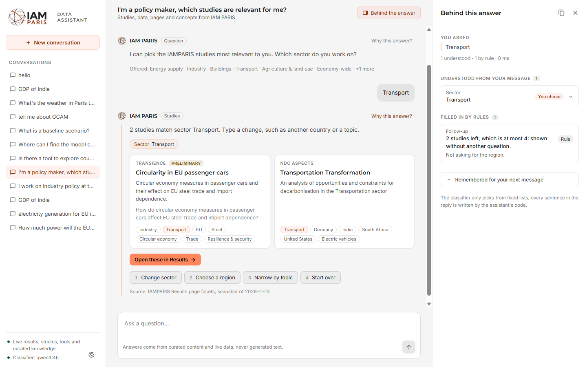

The assistant follows your system's light or dark setting, like the IAMPARIS site. The sun/moon button at the bottom left switches it.

## Tips

- Name what you know: a variable ("solar capacity"), a place ("India", "the EU") and a year ("2040", "2030 to 2050"). Anything left out is assumed and labelled as such.
- Change one thing per follow-up: "only GCAM", "add baseline", "same for Germany".
- Type a number to pick an offered choice.
- If the yellow bar says the classifier isn't reachable, exact wording and the buttons still work. Free phrasing may just get a clarifying question instead.
