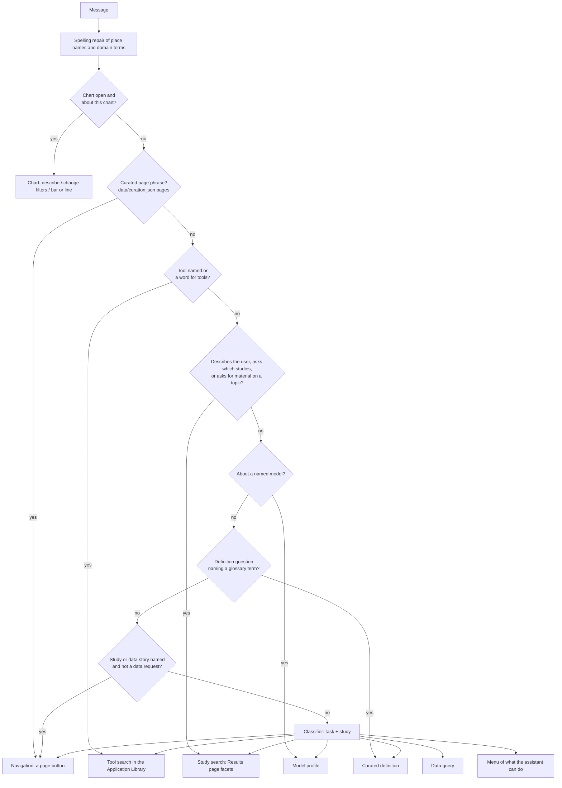

# Every path a user can take on IAM PARIS, and where the assistant leads

This is a map of what people come to iamparis.eu for and how the Ask AI assistant routes each kind of request. It was built on 2026-11-26 from the assistant's code (`apps/server/src/turn/`, `apps/server/src/tools/`), its curated data (`data/*.json`) and the site's frontend (`i2amparis-frontend/src/routes`, the Results page filters in `src/lib/utils/data/studyFilters.js`). For how the routing performs on realistic conversations, see [persona-study/README.md](persona-study/README.md).

## 1. What the site offers

| Area                  | Site path                                                                                                                                        | What is there                                                                                                          | How the assistant reaches it                                                                                               |
| --------------------- | ------------------------------------------------------------------------------------------------------------------------------------------------ | ---------------------------------------------------------------------------------------------------------------------- | -------------------------------------------------------------------------------------------------------------------------- |
| Home                  | `/`                                                                                                                                              | Overview                                                                                                               | Link catalogue (`data/links.json`)                                                                                         |
| Results               | `/results`, filters `?sector=&region=&tag=&project=&q=`                                                                                          | 29 studies, filtered by sector (6), region (13), topic (34) and project (8)                                            | Study search: cards plus "Open these in Results" with the same filters                                                     |
| A project's results   | `/results/<project>`                                                                                                                             | One of 8 projects (PARIS REINFORCE, IAM COMPACT, DIAMOND, NDC ASPECTS, ENCLUDE, DECIPHER, EU-CHINA BRIDGE, TRANSIENCE) | Link catalogue                                                                                                             |
| A study               | `/results/<project>/<study>/policy_questions`, `…/graphs`, `…/harmonization`, `…/insights`, `…/library`                                          | The study's questions, charts, harmonisation notes, insight pages and documents                                        | Link catalogue (12 curated) plus one generated link per Results study from `data/studies.json` (16 more, added 2026-11-26) |
| Analysis (GraphMaker) | `/analysis`, `/analysis/<folder>/<graph>`                                                                                                        | Build and save charts from any study's data                                                                            | Data query → "Open in GraphMaker"; "graphmaker", "configurable analysis" open the page                                     |
| Models                | `/models`, `/models/<model>`                                                                                                                     | About 70 model profiles                                                                                                | Model profile from the CMS registry, "Open model page"; "model documentation", "model catalogue" open the list             |
| Model comparison      | `/models/comparison`                                                                                                                             | Models side by side                                                                                                    | Link catalogue; "compare models", "models side by side"                                                                    |
| SDG coverage          | `/models/sdg`                                                                                                                                    | Which model covers which SDG                                                                                           | Link catalogue; "sdg", "sustainable development goals"                                                                     |
| Data stories          | `/datastories` and six stories: `CE_intervention`, `mitigation_barriers`, `policyCatalog`, `recoveryDB`, `result_indicators`, `tech_inventories` | Curated databases and explorers                                                                                        | Link catalogue; "policy database", "recovery policies", "scenario metadata"                                                |
| Application Library   | `/application_library`, `/application_library/<id>`                                                                                              | 152 external tools, filtered by type (11) and topic (10)                                                               | Tool search: cards, type and topic chips, "Open this search in the library"                                                |
| Projects              | `/projects`                                                                                                                                      | The research projects                                                                                                  | Link catalogue (added 2026-11-26)                                                                                          |
| Documentation         | `/docs/<topic>`: introduction, tutorial, uploading-results, file-format, creating-a-study, … (19 topics)                                         | How contributors publish results, studies and charts                                                                   | Link catalogue (5 pages added 2026-11-26); "upload my results", "file format", "documentation"                             |
| Account               | `/register`, `/login`                                                                                                                            | Sign up, sign in                                                                                                       | Link catalogue (added 2026-11-26)                                                                                          |
| Contact, privacy      | `/contact`, `/privacy`                                                                                                                           | Support, privacy policy                                                                                                | Link catalogue                                                                                                             |
| Old platform          | `old.i2am-paris.eu`                                                                                                                              | Legacy site                                                                                                            | Not offered (only `iamparis.eu` links are used)                                                                            |
| Dashboard             | `/dashboard/*`                                                                                                                                   | Editors' back office                                                                                                   | Not offered (sign-in only)                                                                                                 |

## 2. The assistant's routes

Each new message is routed in this order. The first rule that applies decides; the classifier (Qwen 3 4B, one token per question, accepted at ≥72% and 15 points ahead) is only asked when no rule does.

While a conversation is going on, messages are first read against it:

| Situation                                    | Message                                                                                                    | What happens                                                                         |
| -------------------------------------------- | ---------------------------------------------------------------------------------------------------------- | ------------------------------------------------------------------------------------ |
| Any                                          | "cancel", "start over"                                                                                     | Everything is dropped                                                                |
| Any                                          | A button, or the number of an offered option                                                               | That option                                                                          |
| Any                                          | "what scenarios are in this study?"                                                                        | The study's scenarios, models, regions or variables are listed; nothing else changes |
| Any                                          | "what's an NDC?", "is that a forecast?"                                                                    | The definition; the query, study search or tool search is kept                       |
| Any                                          | "tell me about TIAM"                                                                                       | The model profile                                                                    |
| A data result                                | "only solar", "and wind", "installed capacity instead", "same for Germany", "add baseline", "2030 to 2050" | The query is changed and run again                                                   |
| A study search                               | "what about Poland?", "transport", "include EU-wide studies"                                               | The facets change                                                                    |
| A tool search                                | "what about forests?", "only maps"                                                                         | The search or type filter changes                                                    |
| A question about a page, term, model or task | A data request ("show primary energy in India")                                                            | A new request                                                                        |
| A question about a variable                  | A request naming another place ("carbon price in Europe")                                                  | A new request                                                                        |
| Any                                          | A request for a tool                                                                                       | A new tool search                                                                    |

## 3. Data queries

A data query has five dimensions, resolved in this order, each narrowed by the ones before it:

| Dimension         | Values                                                     | Decided by                                                                                           | When not named                                                                                                                                                                                    |
| ----------------- | ---------------------------------------------------------- | ---------------------------------------------------------------------------------------------------- | ------------------------------------------------------------------------------------------------------------------------------------------------------------------------------------------------- |
| Study (workspace) | 21 studies with data (`data/workspaces.json`)              | Curated phrases (`curation.json` → `studies`), classifier                                            | "Where is the world headed?", or "Where is the EU headed?" when the EU or Europe is mentioned. A specialised study is used only when named                                                        |
| Variable          | 1,422 IAMC variables (`data/variables.json`)               | Curated phrases (`variables`), exact wording, classifier; detail the user did not ask for is dropped | Never assumed: the user is asked, curated aggregates first (`featuredVariables`)                                                                                                                  |
| Region            | 97 named codes (`data/regions.json`) plus ISO names        | Exact wording, classifier                                                                            | World, EU, EU27 or Europe, whichever has data. A named region missing from the study moves the query to a study that has it; if none has the variable, the region's related variables are offered |
| Model             | Per study                                                  | Named only (classifier picks are checked against the wording)                                        | All models with data, up to 24 lines                                                                                                                                                              |
| Scenario          | Per study; readable names in `curation.json` → `scenarios` | Curated phrases ("current policies", "pledges", "net zero"), named only                              | The study's headline scenarios (`headlineScenarios`)                                                                                                                                              |

Years come from the message ("2050", "2030 to 2050", "up to 2050"). Units: models reporting other units than most are left out and named. Results link to GraphMaker with the same filters.

## 4. Study recommendations

From a description of the user ("I advise the transport ministry", "we are a utility in Spain"), a question about which studies matter, or a request for material on a topic ("something about steel"), the Results page facets are filled from the message: curated everyday phrases (`curation.json` → `facets`), then the classifier. The assistant asks for what is still open (sector, then region, then topic) and stops as soon as four or fewer studies remain. Empty results widen step by step: country, then EU-wide, then global.

## 5. Tool search

A tool named outright ("Climate Watch") gets its card. A word for tools ("tool", "dashboard", "database", "map", …) with a subject searches the 152 Application Library entries by word weight; type chips come from wording ("map" → Interactive Maps, `curation.json` → `apps`). Follow-ups change the subject or the type.

## 6. Pages, definitions and models

- Pages: 129 links (113 curated in `data/links.json`, 16 study pages generated from `data/studies.json`). A curated phrase or a page named outright opens it without the classifier; otherwise the classifier picks among them and the pick must share a word with the message.
- Definitions: 26 glossary terms (`data/glossary.json`). A definition is only given when the question names the term or one of its aliases.
- Models: the CMS model registry. "Tell me about X" or "who developed X" gives the profile; "who developed it?" stays on the same model.

## 7. Paths with no route yet

See the [remaining gaps](persona-study/README.md#remaining-gaps): study sub-pages (graphs, harmonisation, insights, library) are not linked separately, "data on climate finance" leads to a study page rather than the library's Finance tools, and several named models or scenarios in one request keep only one.
